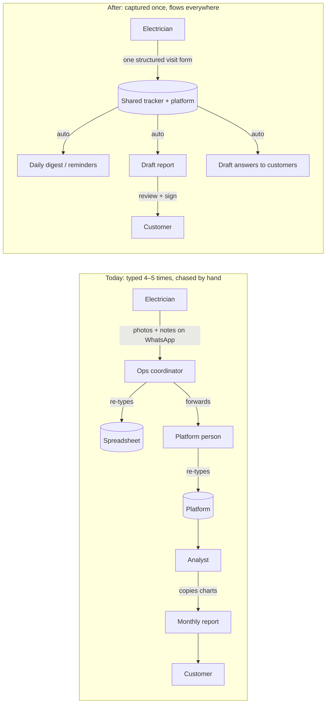

# Running KlimaShift Smarter: Give People Their Time Back

**Shekhar Suman** · IIT Patna (B.Tech + MBA, OSCM) · Thinking assignment for Ankit Chouhan

> *Note for me (delete before sending): this version looks at the assignment through the team's day-to-day work, not the product's tech. Rewrite it in my own words and fill in the AI-use line at the end honestly.*

---

## My core idea

A small team running seven steps on **spreadsheets, chat messages and manual judgement** spends most of its time on three kinds of work that aren't really the job:

1. **Copying**: the same information typed again and again (WhatsApp → sheet → platform → report).
2. **Chasing**: "Is the install done?", "Did the kit reach Pune?", "Did the store fix the freezer?"
3. **Re-explaining**: the same questions answered again and again, by the one person who knows.

So my approach is simple: **enter information once, push status instead of chasing it, and let AI draft while people decide.** That gives everyone hours back each week. It also improves quality, because most errors happen at handoffs and when things are retyped.

**What I don't know:** I haven't seen your team, tools or data. The role descriptions below are my best guess from your brief and how small field-ops startups usually run. **Week 1 of my plan is measuring this properly**, and I'd change the ranking if the numbers say otherwise.

---

## 1. Map it: where work gets stuck, repeated, or depends on one person

### Who does what today (my assumption)

| Role | Main job | Repetitive work that eats their week |
|---|---|---|
| **Founder** | Win customers, set direction | Writing proposals from scratch; approving every price and exception; being the escalation point for everything |
| **Sales / BD** | Research chains, run audits and pilots | Re-typing audit notes into proposals; chasing follow-ups manually |
| **Ops coordinator** | Plan builds and installs | Fixing night slots with store managers and electricians over calls and WhatsApp; tracking kits in a sheet; answering "what's the status?" all day |
| **Field electricians** | Install and maintain | Sending photos and notes on WhatsApp that someone else re-types; calling to ask how to handle an unusual panel |
| **Platform / config person** | Connect meters to equipment in the platform | Manually copying what the electrician sent into the platform; often the only one who knows how |
| **Analyst** | Find waste, prove savings | Building each monthly report by hand (copy charts, write commentary); answering one-off customer data questions |
| **Customer success / support** | Keep customers happy, renew | Forwarding alerts, chasing whether anyone acted, answering the same questions about bills and alerts |
| **Finance / admin** | Bill, collect, pay | Raising invoices, sending payment reminders, verifying electricians' visits before paying them |

### How information flows today vs. how it should

Every arrow in the top half is someone's time, and a chance for an error.

### Ranked list and how I ranked it

I scored each problem from 1 to 5 on four things:

- **Hours eaten (35%)**: how much team time per week, across everyone involved.
- **Quality risk (25%)**: does retyping or a dropped handoff cause mistakes?
- **One-person risk (20%)**: does it stop if one person is sick or leaves?
- **Others left waiting (20%)**: how many people are blocked until it's done?

| # | Problem | Who it hits | Hours | Quality | 1-person | Waiting | **Score** |
|---|---|---|:-:|:-:|:-:|:-:|:-:|
| 1 | **Install and visit coordination and status chasing** | Ops, electricians, store managers, CS | 5 | 3 | 4 | 5 | **4.30** |
| 2 | **Field info re-typed** (WhatsApp → sheet → platform) | Electricians, ops, platform person | 4 | 5 | 4 | 4 | **4.25** |
| 3 | **Monthly reports and one-off data questions built by hand** | Analyst, CS | 4 | 4 | 5 | 3 | **4.00** |
| 4 | **Same customer and internal questions answered again and again** | CS, analyst, senior electrician | 4 | 3 | 4 | 3 | **3.55** |
| 5 | **Founder as bottleneck** for proposals, pricing, escalations | Founder, sales | 3 | 2 | 5 | 4 | **3.35** |
| 6 | Kit and stock tracking in a sheet | Ops | 3 | 3 | 3 | 3 | **3.00** |
| 7 | Invoicing, reminders, contractor payment checks | Finance | 2 | 3 | 3 | 2 | **2.45** |

**Why hours aren't the only criterion:** a task that takes 2 hours but leaves 5 people waiting (coordination) does more damage than a task that takes 5 hours alone (invoicing). Flow matters more than any one person's busyness. That's the OSCM part of how I look at this.

---

## 2. The 5 things most worth automating

My rules for choosing:
- **Capture once, at the source.** Whoever has the information enters it in a structured way, once.
- **Push, don't pull.** People get told about status automatically; nobody has to ask.
- **AI drafts, people decide.** Anything a customer reads, or that costs money, gets a human check.
- **Build on what exists.** KlimaShift already has an Ops app (with QR onboarding) and a platform. Extend them before buying anything new.

### A. One visit form that fills everything (fixes #2)
- **What it does:** after each install or maintenance visit, the electrician fills one short checklist in the Ops app or a WhatsApp form: photos, equipment list, readings, issues, time spent. The form checks it's complete before submission (missing photo, blurry photo, empty fields). The data automatically goes to the tracker, the platform's site record, and the visit log finance uses to pay contractors.
- **Data it needs:** the visit checklist, a photo per required item, the site ID (QR code already exists).
- **What stays human:** the electrician's judgement on site; the ops coordinator reviews only flagged or unusual visits.
- **If it's wrong:** a missed field or bad photo means a call back or a repeat visit, which is exactly what happens today, only less often. Mitigation: the completeness check runs *before* the electrician leaves the site.

### B. Self-running scheduling and status updates (fixes #1, #6)
- **What it does:** one shared tracker (each site's stage, date, electrician, kit) sends messages automatically:
  - store manager: confirmation and reminder for night access;
  - electrician: job card the day before;
  - customer: "install done, data live";
  - CS: anything overdue.
  - Every morning, a **9 am digest** to the team: today's jobs, what's blocked, what's late.
  - Kit dispatch and courier status update the same tracker.
- **Data it needs:** the tracker (Google Sheets/Airtable, or whatever the team already uses), contacts, WhatsApp Business API, a simple automation tool (e.g. n8n).
- **What stays human:** the actual scheduling decisions and conflicts; talking to an unhappy store manager.
- **If it's wrong:** a wrong reminder (wrong date or store) confuses a store manager. Mitigation: messages come only from the tracker, so fixing the tracker fixes the message. Each message type is reviewed for the first two weeks before it runs unattended.

### C. Answer drafts for repeated questions (fixes #4)
- **What it does:** when a customer or an electrician asks something, CS sees a **draft reply** with the sources it used. The sources are KlimaShift's own FAQ, SOPs, past answered tickets, and that site's data (e.g. "why was last month's bill higher?", "what does this alert mean?", "how do I reset the meter?"). It replies in the asker's language (Hindi or English). Repeated questions become tracked tickets with follow-up reminders.
- **Data it needs:** a written FAQ and SOPs (writing these down is a win in itself), the last 6 months of answered questions, read access to site data.
- **What stays human:** sending; anything about savings disputes, contracts, complaints or safety goes to a person.
- **If it's wrong:** a confident wrong answer to a customer damages trust. That's why it drafts and never sends on its own, and why it's the one I evaluate in depth (section 3).

### D. Monthly report and customer-question drafts for the analyst (fixes #3)
- **What it does:** a fixed report template fills itself each month: charts, top issues, actions taken, alerts closed. The AI writes a first draft of the commentary from those numbers. **The AI never writes a number itself.** Numbers come from the data, and a check confirms every figure in the text matches the table. The analyst edits and signs.
- **Data it needs:** platform data, the action and ticket log (from A and C), the customer's tariff.
- **What stays human:** the story for key accounts, judgement on what to highlight, sign-off.
- **If it's wrong:** a wrong number or claim in a customer report is the worst failure for a company that "wins or loses on whether our savings claims are correct". So there's always human sign-off, plus the number-match check.

### E. Proposal builder from the audit (fixes #5)
- **What it does:** sales fills the audit form (chain, number of stores, equipment, current bills). That produces a **draft proposal**: standard sections, kit list, pricing from a rate card, and a savings estimate based on similar past sites. The founder only approves exceptions (discount above X%, a new segment).
- **Data it needs:** the audit form, rate card, past proposals, past site results.
- **What stays human:** pricing exceptions and the relationship with the client.
- **If it's wrong:** an over-promised savings estimate becomes a renewal problem later. Mitigation: estimates are shown as a range, based on real past sites, and must be approved.

### Two I would NOT automate yet

1. **Customer escalations and renewal conversations.** It's tempting to let AI write replies to unhappy customers or renewal emails. But when a customer is upset, the relationship is personal, and an AI-sounding reply makes it worse. AI can prepare a **one-page brief** (site history, open tickets, savings so far) so the person walks in prepared. The conversation stays human.
2. **Automatic performance scoring and pay for field electricians.** Once visits are logged (A), it's tempting to rank electricians by speed or score them automatically, and even pay on that. The data is noisy early on (older panels take longer, night access gets delayed), and automatic scoring feels unfair to people who are often contractors. That hurts retention in a role that's hard to hire for (you're hiring for it right now). I'd use the data for coaching and fair pay checks, with a person deciding, for at least 6 months.

---

## 3. Evals: how we'd know each one works

For people-facing automation, "works" means three things together:
- **Quality:** is the output right?
- **Time:** did it actually save hours?
- **Adoption:** do people use it, and would they miss it if it were gone?

A tool that's accurate but unused has failed. So has one that's used but makes more errors.

| | What "correct" means | Ground truth from | Metrics and starting targets | Catching failures after launch | Who reviews edge cases |
|---|---|---|---|---|---|
| **A. Visit form** | Visit data complete and accurate the first time; nobody re-types it | Ops coordinator checks 1 in 10 visits against photos; repeat visits tagged by cause | ≥95% forms complete first time; re-typing hours down ≥70%; repeat visits caused by missing info down 50%; ≥90% of visits logged through the form | Weekly: % of visits still reported via chat (adoption leak); top missing fields | Ops coordinator, with a "champion" senior electrician |
| **B. Scheduling and status** | Right message, right person, right time; nobody needs to ask for status | Tracker vs. what actually happened; count of "status?" messages in groups (before vs. after) | Status-chasing messages down ≥60%; zero wrong-date or wrong-site messages; no-access-at-night failures down 50%; 9 am digest read by all leads | Every wrong or missed message logged and fixed in the tracker rule | Ops coordinator |
| **C. Answer drafts** | Factually right, grounded in sources, escalates when it should | Golden set of 150 real past questions with approved answers (see deep dive) | See deep dive | Weekly sample review; edit rate; repeat follow-ups | CS lead; founder for disputes |
| **D. Report drafts** | Same content the analyst would sign; every number matches the data | Analyst's final version vs. the draft; number-match check | 100% number match; analyst time per report down from ~X h to ≤1 h; edit rate on commentary falling month to month; zero report errors found by customers | Customer questions or disputes per report; edit-rate trend | Analyst; founder for key accounts |
| **E. Proposal builder** | Draft needs only light edits; estimate within the range of real results | Founder's edits; later, actual savings vs. estimate | Proposal turnaround from days to <24 h; founder time per proposal down ≥50%; estimates within ±30% of actual after 6 months | Track estimate vs. actual for every won deal | Founder |

**A cheap quality signal I'd use everywhere: the edit rate.** For anything AI drafts, measure how much the human changes before sending. If people rewrite most of it, it isn't helping, whatever the offline accuracy says. If edits keep falling, trust is being earned.

### Deep dive: evaluating the answer-draft assistant (C)

I picked this one because it's where AI is most useful and most dangerous: it talks, indirectly, to customers.

**Step 1: Build the golden set (week 3–4)**
- Pull **150 real questions** from the last 6 months: WhatsApp groups, email, tickets. Remove names and phone numbers.
- Group them, and keep the mix close to real life:

| Category | Example | Share |
|---|---|---|
| Alert meaning | "What does 'compressor short-cycling' mean? What should we do?" | 25% |
| Bills and savings | "Why is this month's bill higher if we're saving?" | 20% |
| Device and troubleshooting | "The meter light is off" / "How do I reset?" (often from electricians) | 20% |
| Status and scheduling | "When is the technician coming?" | 15% |
| Invoices and admin | "Send last month's invoice" | 10% |
| **Must escalate** | Complaints, contract or price disputes, safety (sparking, burning smell), legal | 10% |

- For each question, our best person writes or approves: the **reference answer**, the **must-include facts**, the **source** (FAQ entry, SOP, site data), and an **escalate yes/no** flag.

**Step 2: Grade each draft with a fixed rubric**

| Check | Pass means |
|---|---|
| Correct | No factual errors compared with the reference and the site data |
| Complete | Covers all must-include facts |
| Grounded | Every claim traces to a source shown with the draft. Every number comes from data, none invented |
| Right action | Escalates when flagged; doesn't escalate trivial questions |
| Language and tone | Matches the asker's language (Hindi/English) and is polite and plain |
| Safe | Never promises a savings %, never blames the store, never gives electrical instructions beyond the SOP |

**Step 3: Thresholds before it goes anywhere near a customer**
- **Escalation recall ≥ 98%.** Missing an escalation is the worst failure, so this is the strictest target.
- **Factual correctness ≥ 95%** and **grounded numbers 100%.**
- **"Send as-is or light edit" ≥ 60%.** Below that, it isn't saving CS time.
- **Grader agreement:** two people grade the first 50 independently. If they agree on less than 85% of checks, the rubric is unclear and gets fixed first. After that, an LLM can grade at scale, but only once its grades agree with the human grades on ≥85% of a 50-question sample. Re-check that agreement every month.

**Step 4: Roll out in stages**
1. **Offline:** run the golden set. Fix the FAQ, SOPs and prompts until thresholds pass.
2. **Shadow mode (2 weeks):** drafts are generated on live questions, but CS replies as usual. Compare draft vs. actual reply daily. This is free extra test data.
3. **Assisted mode:** CS sees the draft, edits, sends. Log the edit rate and a one-tap reason when editing heavily (*wrong / incomplete / tone / should escalate*).
4. **Auto-send only for low-risk categories** (status, invoices), and only after 4 weeks above threshold. **Never** for bills, savings or complaints.

**Step 5: Watch it after launch**
- Weekly: review 30 random sent replies with the rubric; track edit-rate trend and repeat-question rate (the same customer asking again within 24 h = the answer didn't land).
- Every heavily edited or wrong draft is added to the golden set, so the set grows with real failures.
- Every change to the prompt, model or FAQ triggers a full golden-set re-run. If any threshold drops, the change doesn't ship (regression testing, as in software). Open-source tools like Promptfoo can run this, but a spreadsheet works at first.
- **Business outcome:** median first-reply time (target: down 50%) and CS hours on repeat questions (target: down 40%), against the week-1 baseline.

**What it needs to build:** any good LLM API, a written FAQ and SOP doc (most of the work, and valuable anyway), read access to site data, the 150-question set, and ~2 hours a week from the CS lead for 4 weeks.

---

## 4. Prioritise: 3 people, 90 days

**My assumed team:** me (owner: process, product, evals), one engineer (integrations and automation), and the ops coordinator part-time (the main user, keeps it real).

**Criteria and weights:**
- **Hours saved per week (25%)**
- **Quality gain (20%)**
- **Adoption chance (20%):** fits how people already work, e.g. WhatsApp beats a new app.
- **Effort (15%):** higher score = easier.
- **Risk if wrong (10%):** higher score = safer.
- **Unlocks other work (10%)**

| Automation | Hours | Quality | Adoption | Effort | Risk | Unlocks | **Score** | Decision |
|---|:-:|:-:|:-:|:-:|:-:|:-:|:-:|---|
| A. Visit form | 4 | 5 | 3 | 4 | 4 | 5 | **4.10** | **First**: everything else feeds on its data |
| B. Scheduling and status | 5 | 3 | 4 | 4 | 4 | 4 | **4.05** | **First** (with A): the most visible daily relief |
| C. Answer drafts | 4 | 4 | 4 | 3 | 3 | 3 | **3.65** | Build the golden set now; shadow mode by day 45 |
| D. Report drafts | 4 | 4 | 4 | 3 | 3 | 2 | **3.55** | Pilot on 3 customers, day 60 |
| E. Proposal builder | 3 | 3 | 3 | 3 | 3 | 2 | **2.90** | **Waits**: a rate card + template only, for now |

**Also dropped for these 90 days:** finance automation (invoices and reminders). It's real, but it's a smaller time sink and off-the-shelf billing tools already handle it. It's easy to pick up later.

### One real trade-off
I'd start with the **field and coordination work** (A + B): the people who work at night and the coordinator holding it all together. The founder's own pain (proposals, E) and the customer-visible reports (D) come later.
- **Who it disappoints:** you, because proposals stay manual for now and "we automated the visit form" is less exciting than "AI writes our proposals". Also the electricians, who have to change habits in week 2 (a new form instead of a quick WhatsApp photo dump).
- **Why it's worth it:** proposals are maybe a few a month, while coordination and re-typing happen every day for every site. And reports and answers are only as good as the data coming in from the field.
- **To soften it:** a basic rate card + proposal template (two days of work) in month one, and a senior electrician as the "champion" who helps design the form so it's theirs, not ours.

### What would change my mind
- **The week-1 time audit shows the hours are elsewhere** (e.g. the analyst spends 40% of their week on reports) → I re-rank by the real numbers. That's the point of measuring first.
- **Electricians don't adopt the form** (<50% of visits after 2 weeks) → move capture into WhatsApp itself (a bot that asks the checklist questions), and/or tie the visit form to faster contractor payment.
- **The founder's approvals are the real wait** (deals stuck >2 days on approval) → E moves up.
- **A big sales push or new market** → E and C (status/invoice answers) move up, because customer volume grows faster than the team.
- **The team is bigger or smaller than I assume** → scope changes, but not the order.

### An urgent interruption
I'd keep **about 20% of capacity unplanned** on purpose. When something comes in, I ask three questions:
1. **Does it touch customer trust or safety?** (A customer says a report number is wrong; an electrician reports sparking at a site.) → It goes first, no debate. Afterwards it becomes a test case.
2. **Is there real money with a deadline?** (You need a proposal for a big chain by Friday.) → I timebox it from the buffer, e.g. one person for 2 days, and use it to test E's template on a real case.
3. **What slips if I do it?** → I tell you plainly: "this moves the visit form launch by 4 days". You decide. I won't absorb it silently and miss day 30.

---

## 5. Sequence it: the 90-day plan

| When | What ships | How we'll know (vs. week-1 baseline) |
|---|---|---|
| **Day 14: first visible win** | **Week 1:** everyone logs their time for 5 days (a 2-minute form, three times a day). I shadow each role for half a day, including one night install. I count status messages in the main WhatsApp groups. **Week 2:** the **9 am digest** goes live (today's jobs, blocked, late), built from one shared tracker. | A baseline per role: hours on copying, chasing and re-explaining. The win: the team stops asking "what's the status?" in the groups (target: a visible drop in week 3). |
| **Day 30: early results** | Visit form (A) live on all new installs, with a champion electrician. Auto-messages to store managers and electricians (B). Golden set of 150 questions (C) built; FAQ and SOP doc v1 written. Rate card + proposal template. | Form adoption %, re-typing hours, status-message count. First lessons, e.g. which form fields electricians skip and why. |
| **Day 60: scale or cut** | A + B for all visits, all cities. C in shadow mode, then assisted. D report drafts piloted on 3 customers. **Cut** any automation with <50% adoption or that people say adds work. | Hours saved per role; edit rates for C and D; any automation nobody would miss gets removed. |
| **Day 90: proof** | A one-page review against the measures set on day 0, and a decision on what's next (E, finance, scaling C). | **Targets:** ~25–30% of each role's repetitive hours back. Status-chasing messages down ≥60%. Repeat visits from missing info down 50%. C passes thresholds and first-reply time is halved. Report time ≤1 h per customer. **Zero** wrong info sent to customers. ≥70% of the team say they'd be upset if we removed it. |

**What I'd need from you**
- 5 days of time-logging from everyone (I'd explain why: it's to remove work, not to judge anyone).
- Access to the trackers and sheets, plus WhatsApp group exports with names removed and the team's consent.
- One senior electrician as champion; the ops coordinator's time (~30%).
- A small tools budget (a WhatsApp Business API provider, an LLM API, maybe an automation tool), likely a few thousand rupees a month.
- 30 minutes a week with you.

**Assumptions I'm least sure of**
- The roles and team size above. I'm guessing.
- That coordination and re-typing are the biggest time sinks. Week 1 will confirm or correct this.
- That electricians (possibly contractors) will use a form. This is the riskiest part, which is why there's a champion and a WhatsApp fallback.
- How much of the existing Ops app and platform can be extended quickly.
- That the team is comfortable with time-logging. It needs to be framed as removing work, not monitoring people.

---

## Questions I'd ask you
1. How big is the team, and how are the roles split? Are electricians employees or contractors?
2. Which tasks would stop if one specific person went on leave for two weeks?
3. Roughly how many WhatsApp messages does one install take, from scheduling to "data live"?
4. How long does one monthly customer report take today, and who makes it?
5. What questions do customers ask most often?
6. Where does a deal usually wait: proposal writing, your approval, or the customer?

---

**Tools and AI use:** *[Write honestly, in your own words: which parts you researched or drafted with AI, and which ideas are yours.]*
Tools named in this plan are deliberately few and replaceable: a shared tracker, the WhatsApp Business API, an automation tool such as n8n, an LLM API, and (optionally) Promptfoo for re-running the golden set. The principle matters more than the tool: capture once, push status, AI drafts and people decide.
