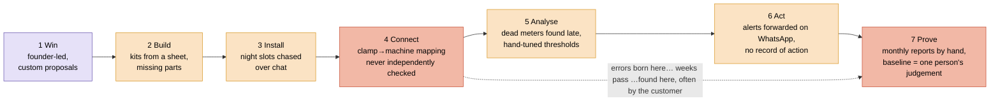
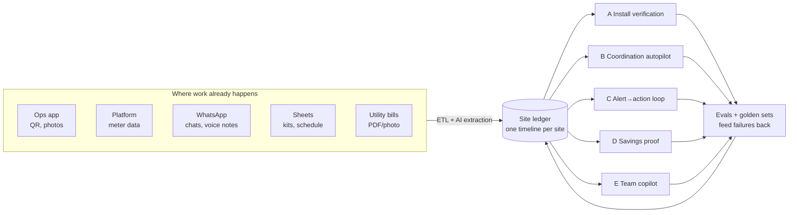

# Running KlimaShift Smarter

**Shekhar Suman** · IIT Patna, B.Tech + MBA (OSCM) · Thinking assignment for Ankit Chouhan · October 2026

> *Note for me (delete before sending): rewrite in my own words, keep my core-ideas note separate as Ankit asked, and fill in the AI-use line at the end honestly.*

---

## Before the answers: what I checked, and what I'm not assuming

I didn't want to solve 2024's problems, so I looked at where KlimaShift and its market are **today**.

- **You're already fixing parts of this.** Your Ops app added QR-code onboarding for meters, sensors and controllers (Aug 2026), and your customer app was updated this month. So I build on what exists instead of proposing to replace it. QR tells you *which device* was installed. It doesn't tell you *whether the clamp is on the right machine, the right way round*. That gap is where I start.
- **In 2026, automation is cheap; trusting it is the hard part.** Turning messy chats, Hindi voice notes and site photos into structured data now costs very little:
  - Meta launched its Business Agent on WhatsApp in India in July 2026.
  - Indian speech AI (Sarvam, Bolna, Smallest.ai) handles Hindi well.
  - Vision models can check installation photos.

  So the bottleneck has moved from *"can we automate this?"* to *"can we prove the automation is right?"*. That's why evals are the centre of this document, not an afterthought.
- **Your customers' rules changed, and that changes what "savings" means in ₹.**
  - National rules require Time-of-Day tariffs for commercial users above 10 kW, though rollout varies by state.
  - Maharashtra moved commercial users above 20 kW to kVAh billing in 2025, so poor power factor now shows up directly on the bill.
  - Smart meters are only ~28% of the national target (June 2026), so utility interval data is still patchy. Your own meters remain the source of truth.
  - Many QSR franchisees are listed companies. SEBI's BRSR Core brings energy disclosures under third-party assurance or assessment, phased in to the top 1,000 listed companies by FY2026-27.
- **The market is crowded.** Energy monitoring and dashboards are becoming table stakes (e.g. Aliste raised ₹30 Cr in April 2026 for IoT energy management). What's hard to copy is **cheaper, faster, more reliable operations per site** and **savings claims a customer's CFO trusts**.

**What I don't know:** I haven't seen your data, team or tools. Every number below is a public fact, a stated assumption, or a starting target I'd reset after week 1.

---

## My core idea

> **KlimaShift sells numbers people can trust, delivered by a small team. So: capture every fact once, check it at the source, and make every claim provable.**

Two things follow from that.

1. **Errors are born upstream and found downstream.** A reversed clamp at 2 a.m. (step 3–4) shows up weeks later as a strange savings report (step 7), often spotted by the customer. Checking at the source is the cheapest quality there is.
2. **Most of the team's time goes on copying, chasing and re-explaining.** The same information is typed again and again (chat → sheet → platform → report). Each retype costs hours and creates a chance for an error.

This is also exactly what I said I wanted to work on: **data → automation → evals, owned end to end.** I've built the same pattern twice. **EcoVerify** checks a company's climate claims against real hazard data; *Prove* is the same problem pointed at our own savings claims. At **Quest Global** I built a knowledge graph over messy warehouse data; KlimaShift's ops data lives in chats and sheets in the same way.

---

## 1. Map it: where work gets stuck, repeated, or depends on one person

*Red = errors and trust risk · amber = repeated or stuck work · purple = depends on one person.*

### Ranked list and how I decided

I scored each problem 1–5 on four criteria and weighted them:
- **Customer trust (35%):** does it put savings claims, alerts or the renewal at risk?
- **Team hours (25%):** how much time per week, across everyone it touches, including people left waiting?
- **One-person risk (20%):** does it stop if one person is away?
- **Late discovery (20%):** how far downstream is the mistake found?

Late discovery is the criterion most people skip, and it's the one that matters most for a trust business. An error caught at the panel costs one minute. The same error caught by the customer costs the account.

| # | Where it hurts | Step | Trust | Hours | 1-person | Late | **Score** |
|---|---|:-:|:-:|:-:|:-:|:-:|:-:|
| 1 | **Install and mapping never independently verified** (reversed clamp, wrong phase, wrong machine label) | 3–4 | 5 | 4 | 4 | 5 | **4.55** |
| 2 | **Savings proof and monthly reports by hand**; baseline depends on one analyst | 7 | 5 | 4 | 5 | 3 | **4.35** |
| 3 | **Alert → action loop is open**: dead meters and data gaps found late, alerts forwarded with no record of action or result | 5–6 | 4 | 4 | 3 | 4 | **3.80** |
| 4 | **Coordination and status chasing**: night access, electricians, kits, "is it done?" | 2–3 | 3 | 5 | 4 | 3 | **3.70** |
| 5 | **Knowledge in people's heads**: the same customer and electrician questions answered again and again | all | 3 | 4 | 5 | 2 | **3.45** |
| 6 | Proposals and audits rebuilt from scratch, waiting on the founder | 1 | 3 | 3 | 5 | 1 | **3.00** |
| 7 | Kit and stock tracking in a sheet | 2 | 2 | 3 | 3 | 4 | **2.85** |

**How I'd replace my guesses with data in week 1.** With the team's consent and names removed, I'd export the WhatsApp groups and sheets for the **last 20 installs** and rebuild each site's timeline as events: *surveyed → kit shipped → install scheduled → installed → data live → first report*. That gives real cycle times, rework counts (repeat visits, re-mapped channels) and who touched what. It's the first ETL job, and it turns this ranking from opinion into measurement. I'd add a 5-day time log for the team. Two flow metrics would run from then on: **install-to-trusted-data time**, and **first-pass yield** (the share of sites that are right the first time).

---

## 2. The 5 things most worth automating

**How I chose:** automate the **capturing, checking and chasing**. Hand AI the **messy-input and first-draft** work: chats, voice notes, photos, written explanations. Keep people on **judgement, money, and anything a customer reads**. Detection (is this channel wrong? is this freezer short-cycling?) stays **rules plus each site's own statistics**, not black-box ML. It's easier to test and explain, and benchmarks such as TSB-AD show simple methods often match deep models on this kind of data.

### A. Install verification: a "site acceptance test" before the electrician leaves
- **What it does:** when the kit powers up, the platform runs checks on every channel:
  - Is data arriving?
  - Is power **negative** (clamp reversed)?
  - Is the **power factor impossible** for that machine, e.g. a compressor below 0.3 (clamp on the wrong phase)?
  - Is current outside the nameplate range?
  - Is the meter's own supply voltage sagging (the Dunkin' SMPS issue)?

  Then a **switch test**: the Ops app asks the electrician to switch machine X off and on, and confirms the *right* channel dropped. A vision model checks the required photos (panel, clamps, labels) are present and readable. Machines that can't be switched (walk-in freezers) are verified from their compressor cycles over the next 24 hours.
- **Data:** live channel readings, the planned channel map from the survey, machine type and nameplate, switch-test timestamps and photos (the Ops app's QR step is the anchor).
- **Stays human:** fixing faults; overriding a check (reason + photo, every override reviewed).
- **If it's wrong:** a false pass lets bad data through, which C catches later. A false fail wastes an electrician's night, so overrides are allowed and tracked as a quality signal.

### B. Coordination autopilot, built on a site ledger
- **What it does:** every site gets **one timeline** filled automatically from the Ops app, platform, sheets and WhatsApp. AI turns an electrician's Hindi voice note or photo dump into a structured visit log (*what was done, parts used, issues, time*). From the ledger:
  - store managers get access confirmations and reminders for night installs;
  - electricians get job cards;
  - customers get "install done, data live";
  - the team gets a **9 am digest** of today's jobs, what's blocked and what's late.
- **Data:** the sources above; contacts and roles; kit dispatch status.
- **Stays human:** scheduling decisions and conflicts; any difficult conversation with a store or customer.
- **If it's wrong:** a misread voice note puts a wrong fact in the ledger, and a wrong reminder confuses a store. Mitigation: extracted facts show a confidence level, low-confidence ones go to the coordinator for confirmation, and every message comes from the ledger, so fixing the ledger fixes the message.

### C. Alert → action loop: fewer alerts, each one closed
- **What it does:** two kinds of detections become **one ranked morning queue**.
  - **Data health:** gaps, flatlines, offline devices, unexplained step changes, meter vs bill mismatch.
  - **Waste and risk:**
    - equipment on after closing;
    - freezer short-cycling (starts per hour above 2× that unit's own 30-day normal);
    - power factor below 0.9 on kVAh-billed sites;
    - high load in the ToD peak window;
    - cold-storage temperature excursions.

  The queue is de-duplicated and ranked by ₹ or risk, then each alert is routed on WhatsApp to the right person (store manager, facilities, or our field team) with one-tap ***Done / Not useful***. Afterwards the system checks the energy data: **did the action actually work?** An LLM only writes the alert in plain Hindi or English.
- **Data:** meter and sensor data, store hours, tariff (ToD/kVAh), contact roles, feedback taps, ticket outcomes.
- **Stays human:** anything that looks like an equipment failure; any customer escalation; truck-roll decisions.
- **If it's wrong:** false alerts teach customers to ignore *all* alerts, the biggest risk, so each store has an **alert budget**. A missed cold-storage excursion is a food-safety issue, so that class is always sent and never throttled.

### D. Savings proof: every claim with a method and a range
- **What it does:**
  1. data passes C's health checks;
  2. a baseline model (energy vs outdoor temperature, store hours, day of week; open-source **OpenDSM**, formerly OpenEEmeter) gives avoided kWh **as a range**;
  3. ₹ is calculated with the site's real tariff (ToD windows, kVAh, power-factor terms);
  4. change-point detection (**ruptures**) flags unexplained jumps for the analyst to label;
  5. an LLM drafts the narrative.

  **The LLM never writes a number.** Code inserts every figure, and a check confirms every number in the text matches the table. Where a customer is a listed franchisee, the same data exports in a **BRSR-ready** energy format for their sustainability team.
- **Data:** site energy, hourly weather (Open-Meteo), store hours and closures, action log (from the ledger), tariff, utility bills; optionally daily sales or footfall.
- **Stays human:** labelling non-routine events; signing every report.
- **If it's wrong:** an over-claim the customer discovers loses the renewal; an under-claim leaves value unproven. This is the deep-dive eval below.

### E. Team copilot ("Ask KlimaShift")
- **What it does:** drafts answers for whoever asks — customer support, a new electrician, sales — **grounded in** the ledger, site data, SOPs and past answered tickets, with sources shown. Examples: "Why was last month's bill higher?", "What does this alert mean?", "How do I wire this panel type?". It also turns an audit form into a **draft proposal** from the rate card and similar past sites, so proposals stop waiting on the founder's blank page.
- **Data:** a written FAQ and SOPs (writing these is a win in itself), the last 6 months of answered questions, read access to site data, the rate card.
- **Stays human:** sending; pricing exceptions; anything about savings disputes, contracts, complaints or electrical safety.
- **If it's wrong:** a confident wrong answer damages trust, so it drafts and never sends. Escalation categories are hard-coded.

### Two I would NOT automate yet

1. **Failure prediction as a product feature.** It's the most tempting AI story, but there's no labelled failure history yet, failures per site are rare, and a wrong "your freezer will fail" costs trust fast. For now: rules-based "watch" signals inside C (rising duty cycle, short-cycling), and **start collecting labels today**: every ticket closed with *what actually broke*. In 6–12 months that becomes the training and eval set.
2. **AI acting on its own toward customers or equipment.** In 2026 you can switch on an AI agent that replies to customers by itself, or let the platform turn equipment off. I wouldn't do either yet for anything involving bills, savings or kitchen equipment. One wrong autonomous message about a customer's bill, or one freezer switched off during service, costs more than months of saved effort. Agents draft and recommend; people send and approve. That changes only after the evals show the error rates are acceptable.

---

## 3. Evals: how we'd know each one works

For each automation I track three things together: **quality** (is the output right?), **time** (did it save hours?) and **adoption** (do people use it, and would they miss it?). A cheap signal I'd use for every AI draft is the **edit rate**: how much a person changes before sending. If people rewrite most of it, it isn't working, whatever the offline accuracy says.

| | "Correct" means | Ground truth from | Metrics and starting targets | Caught after launch by | Edge cases go to |
|---|---|---|---|---|---|
| **A** Verify | Every channel on the right machine, right polarity, right phase | Switch tests; 1-in-10 re-check by a senior engineer; any mapping error found within 30 days | Escaped mapping errors <2% of channels; false-fail <10%; install-to-trusted-data ≤48 h | Every escaped error becomes a new automatic check | Hardware/ops lead |
| **B** Ledger + coordination | The ledger matches what really happened; nobody has to ask for status | 100 hand-labelled chat messages, voice notes and photos per month; status messages in groups before vs after | Extraction precision ≥95% on key fields (site, date, action, parts); "status?" messages down ≥60%; zero wrong-date or wrong-site reminders | Low-confidence extractions queued for the coordinator; monthly re-label | Ops coordinator |
| **C** Alert loop | The recipient agrees it's real and worth acting on, and the data confirms the action worked | Feedback taps; energy data after action; 50 alerts a week labelled by an analyst; replay of past incidents | Precision ≥70%; recall on replayed incidents ≥90%; ≤3 non-critical alerts per store per week; 100% of cold-storage excursions sent | A falling "Done" rate is the first sign of alert fatigue | Analyst + account owner |
| **D** Savings proof | The claim is inside the model's error band and counts only savings KlimaShift caused | Backtests, placebo stores, injected savings, utility bills | See deep dive | Disputes; monthly placebo re-run | Analyst; 2nd reviewer for claims >20% |
| **E** Copilot | Correct, grounded, escalates when it should | Golden set of 150 real past questions with approved answers | Factual ≥95%; escalation recall ≥98%; ≥60% sent as-is or lightly edited; first-reply time halved | Weekly review of 30 sent replies; edit-rate trend; repeat questions within 24 h | Support lead; founder for disputes |

### Deep dive: the savings-proof eval (D), detailed enough to build

I picked D because it's the one your brief calls *the catch*, and it's the one most like EcoVerify: check a claim against independent evidence before anyone else does.

**The real difficulty is that there's no clean "before".** The meter goes in on day 1, so there's no hourly history from before KlimaShift, and smart-meter data from utilities is still patchy in 2026. So I'd build "before" from three sources:
1. a **2–4 week observation period** after install, with no actions taken;
2. **12 months of utility bills**, for a monthly cross-check;
3. **control stores**: a chain rolls out in stages, so for a while some stores are untreated. That makes a chain a natural experiment.

**Unit of evaluation:** one site-month savings claim.

| # | Test | How it works | Pass (starting thresholds) |
|---|---|---|---|
| 1 | **Backtest ("placebo in time")** | On sites with ≥8 weeks of data before any action, fit on weeks 1–4 and predict weeks 5–8. Nothing changed, so any "savings" is model error. | Daily NMBE (bias) within ±5%, CV(RMSE) (noise) ≤20%. My starting point sits between ASHRAE Guideline 14's monthly (±5% / 15%) and hourly (±10% / 30%) limits. Output a **minimum claimable saving** per site (~2× its backtest error). Anything below is reported as "within noise". |
| 2 | **Placebo stores ("placebo in space")** | Run the full pipeline on untreated stores of the same chain; claimed savings should centre on zero. | False-claim rate (untreated store-months where we'd claim >5%) ≤5%. |
| 3 | **Injected savings** | Take untreated data and subtract a known change: e.g. 1.5 kW from 23:00–06:00 to mimic an overnight fix, or a flat 3/5/10/20%. Run the pipeline and compare. | Estimate within ±20% of the injected value for injections at or above the minimum claimable saving. This gives a **detection curve**: the size of saving we can honestly prove per site type. |
| 4 | **Bill reconciliation** | Monthly meter kWh vs the utility bill's main meter; ₹ recomputed from our tariff engine vs the bill. | kWh gap ≤3% (otherwise the report is blocked and a C ticket opened); ₹ gap ≤2% over 3 months (tests ToD/kVAh handling). |
| 5 | **Non-routine events** | Change-point detection on model residuals flags step changes not in the action log. | 100% of flags labelled (*our action / store change / data issue*) before the report can be sent. |
| 6 | **Number check** | Every number in the drafted text is compared with the computed table. | 100% match, or the report doesn't send. |

- **Golden set:** about 30 site-months (past reports with known or disputed outcomes, plus injected cases), re-run on **every** method change, like regression tests in software. A change that breaks a threshold doesn't ship.
- **After launch:** customer disputes per report (target: zero); placebo false-claim rate re-run monthly; share of reports blocked by data gates (rising = a field problem upstream); whether savings hold after month 3.
- **Who reviews:** the analyst signs every report; a second reviewer for any claim above 20% or below 0; the founder for disputes.
- **Build:** Python with OpenDSM (baselines), ruptures (change points), Open-Meteo (weather), and a small tariff table per state. Output is the existing report plus a one-line method note.
- **What the customer sees:** "18% ± 4% (method X, 3 days excluded: store closed)" instead of a bare "25%". I think the range is a renewal *asset*. It's what a franchisee's CFO, or their BRSR assessor, will trust.

---

## 4. Prioritise: 3 people, 90 days

**Assumed team:** me (owner: process, product, data, evals), one engineer (pipelines and integrations), and one field/ops person at ~50% (the main user, who keeps it real).

**Capacity, the OSCM way:** 3 people × ~60 working days, with the field person at half time, is roughly **150 person-days**. I hold back 20% for interruptions, which leaves **~120 to plan**. Everything has to fit in that.

**Criteria:** customer impact 30%, data readiness 20%, effort 20% (higher = easier), risk if wrong 15% (higher = safer), unlocks other items 15%.

| Item | Impact | Data ready | Effort | Risk | Unlocks | **Score** | Person-days | Decision |
|---|:-:|:-:|:-:|:-:|:-:|:-:|:-:|---|
| B Ledger + coordination | 4 | 4 | 4 | 4 | 5 | **4.15** | 30 | **First**: everything else reads from it |
| A Install verification | 4 | 4 | 4 | 4 | 5 | **4.15** | 25 | **First** (with B) |
| D Savings proof | 5 | 3 | 2 | 2 | 4 | **3.40** | 35 | Eval from week 3; drafts from day 45 |
| C Alert loop | 4 | 3 | 3 | 3 | 3 | **3.30** | 20 | Pilot on one chain from day 60 |
| E Copilot | 3 | 2 | 3 | 3 | 2 | **2.65** | 10 | Golden set + shadow mode only |
| Kit automation, failure-prediction ML, proposal pricing logic | — | — | — | — | — | — | 0 | **Dropped for these 90 days** |

*C and D are nearly tied. I put D first because renewals depend on it, and its eval (the backtest) is cheap to start early. The weights matter less than the order they produce.*

### One real trade-off
The first ~6 weeks go on the **unglamorous foundation (ledger + verification)** instead of the most demo-able AI features: a predictive-maintenance demo or a copilot that answers customers.
- **Who it disappoints:** you and sales, because "we verify every clamp" doesn't pitch like "AI predicts failures". Also the analyst, who keeps building reports by hand until ~day 45.
- **Why it's worth it:** automating reports or alerts on unchecked data just produces wrong answers faster, and in a trust business that's worse than slow.
- **To soften it:** D's backtest starts in week 3, so the analyst sees progress early. The day-14 numbers (real cycle times and rework) are something you can use with customers and investors.

### What would change my mind
- **The week-1 ledger shows mapping errors are rare** (<2% of channels) → A shrinks to a checklist and its days go to C.
- **A big renewal is due within 60 days** → D moves first, done semi-manually for that account.
- **A listed franchisee asks for BRSR-ready energy data** → D's export moves up; it becomes a reason to renew.
- **ToD is actually being enforced** in your customers' states → peak-window alerts lead C, because that's real ₹ for the customer.
- **Electricians won't use the new step** (<50% after 2 weeks) → capture moves fully into WhatsApp voice notes, and/or faster contractor payment is tied to complete logs.
- **Installs are about to multiply 5×** (a big chain signs) → kit automation comes back, because throughput becomes the bottleneck.

### An urgent interruption
The 20% buffer exists for this. I ask three questions:
1. **Does it touch trust or safety?** E.g. a chain says "your report says 18% saved but our bill went up", or an electrician reports sparking. → It goes first, no debate, and becomes a golden-set case afterwards.
2. **Is there real money with a deadline?** E.g. you need a pilot proposal for a big chain by Friday. → I timebox it (one person, 2 days) from the buffer, and use it to test E's proposal draft on a real case.
3. **What slips if I do it?** → I tell you plainly: "this moves the switch-test rollout by 4 days". You decide. I won't absorb it silently and miss day 30.

---

## 5. Sequence it: the 90-day plan

| When | What ships | How we'll know (vs week-1 baseline) |
|---|---|---|
| **Day 14: first visible win** | **Week 1:** rebuild the last 20 installs as timelines from chat and sheet exports; 5-day team time log; shadow one night install; audit every channel on ~20 live sites. **Week 2:** ledger v0 (sheet or DB) + the **9 am digest**, and a daily script running the first data-health checks across *all* sites. | First real numbers: install-to-trusted-data time, repeat visits, % bad channels, hours spent copying, chasing and re-explaining per role. **The win:** "found N broken or mis-mapped channels across M sites, fixed the top ones", plus a digest the team reads every morning. |
| **Day 30: early results** | A v1 (auto-checks + switch test + photo check) on every new install. Voice note → visit log extraction live with the champion electrician. Auto reminders for night access. **D: backtest the current savings method on 10 sites.** E: golden set of 150 questions and FAQ v1 written. | Escaped mapping errors on new installs tracked weekly; extraction precision; "status?" messages trending down. First lessons written up, e.g. which checks misfire at night, and the noise floor of today's savings method. |
| **Day 60: scale / cut** | A + B on all installs and cities. C pilot on one chain (alert budget, feedback taps, did-it-work check). D drafts for 2 customers with analyst sign-off and placebo-store results. E in shadow mode. **Cut** any check with <50% precision and any step people say adds work. | Ticket and alert precision; report prep time (target ≤1 h review per customer); edit rates; adoption per automation. |
| **Day 90: proof** | One-page review against the measures set on day 0, and a decision on what's next: failure-prediction labels, E assisted mode, kit automation if volume grows. | Escaped mapping errors **<2%**; install-to-trusted-data **≤48 h**; ≥98% of site-days with complete data; **every savings claim carries a range and passes the backtest**; **zero** disputed reports; C precision ≥70% on the pilot chain; ~25% of repetitive team hours back; ≥70% of the team say they'd be upset if we removed it. |

**What I'd need from you**
- Read access to raw device data, the platform DB, past reports, tickets and sheets.
- WhatsApp exports with names removed and the team's consent; I'd explain it's to remove work, not to watch anyone.
- Permission to add steps to the Ops app.
- One senior electrician as champion, and the field team's time for the week-1 audit and switch tests.
- Utility bills and tariff category for pilot sites; intros to 2–3 store or facilities managers.
- A small tools budget (LLM API, WhatsApp Business Platform, speech-to-text), and 30 minutes a week with you.

**Assumptions I'm least sure of**
- How savings are calculated today, and how customers will react to a range.
- That mapping and data errors are common enough to matter. Your QR work may already have reduced them, and week 1 will tell.
- Team shape: who the 3 people are, and whether electricians are employees or contractors.
- That store hours and closures, and ideally sales, can be obtained from chains.
- How quickly the Ops app and platform can be changed.

## Questions I'd ask you
1. How many sites and chains are live, and how many installs a month?
2. How is the savings % calculated today: what baseline, adjusted for what? (e.g. the 25% at McDonald's Poland)
3. Since QR onboarding shipped, how often is a channel still mis-mapped or a device unhealthy after install, and how is it found?
4. What share of alerts lead to an action? Has a customer ever said "too many alerts"?
5. Are any customers asking for BRSR or ESG-ready energy data yet?
6. Which tasks would stop if one specific person went on leave for two weeks?

## What I'd own
If this becomes my first project, I'd want to own **the site ledger plus the savings-proof eval (B + D) end to end**: from pipelines to the report the customer signs off on. That's where my data and automation work, the eval work, and my supply-chain training meet. Its success is measured by one thing you already care about: **renewals that don't need arguing over numbers.**

---

**Tools and AI use:** *[Write honestly in your own words: where you used AI for research or drafting, and which ideas are yours.]*
Tools are named only where they solve a specific step:
- **OpenDSM, ruptures, Open-Meteo:** savings proof.
- **An LLM with vision, plus Indian speech-to-text** (e.g. Sarvam): reading chats, voice notes, photos and bills.
- **WhatsApp Business Platform + n8n:** alerts and reminders.
- **Langfuse** (open source; self-hosting still supported after ClickHouse acquired it in 2026): logging AI calls and re-running golden sets.

I deliberately skipped heavier options: building ontologies, time-series foundation models, autonomous agents.

**Sources (checked Oct 2026):** KlimaShift Ops app & customer app (Google Play), KlimaShift LinkedIn · Meta Business Agent India launch (India TV News, Jul 2026) · Indian voice AI: Bolna seed (bolna.ai), Sarvam (Wikipedia) · ToD rule: Ministry of Power concept paper (Jan 2026) · Smart meters: Ministry of Power, Rajya Sabha reply (Jul 2026) · kVAh: Adani Electricity / MERC order (Mar 2025) · BRSR Core: SEBI board paper (Dec 2024), India Briefing · Aliste funding (Realty+ Apr 2026) · OpenDSM (LF Energy) · ASHRAE Guideline 14 thresholds (secondary) · TSB-AD (NeurIPS 2024) · Langfuse–ClickHouse (Orrick, Jan 2026).
